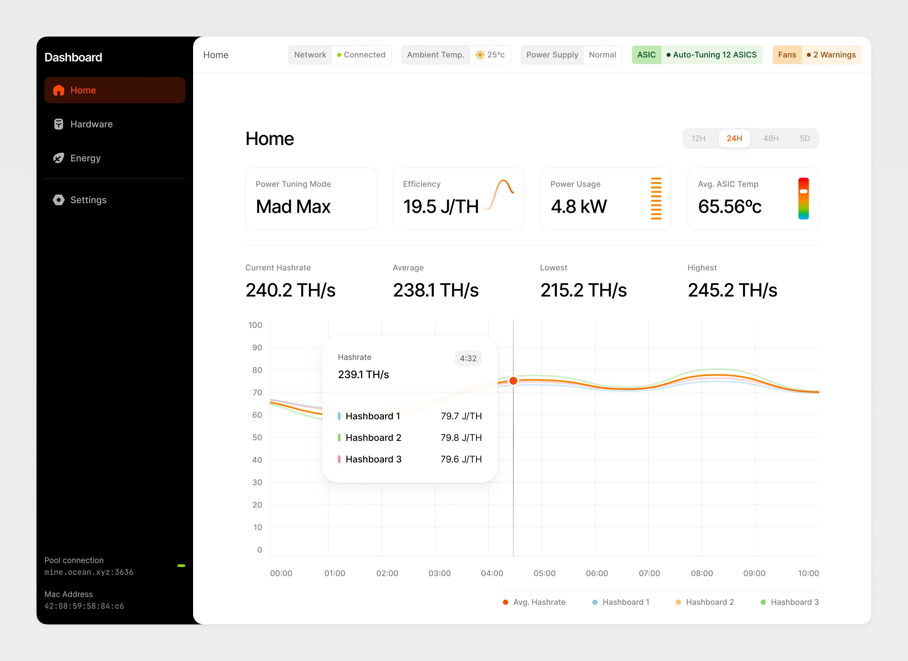
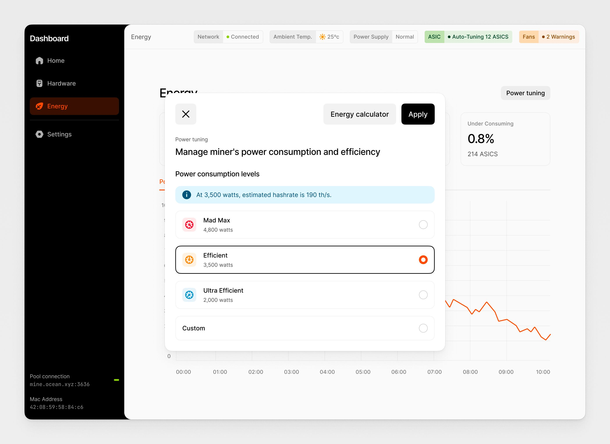
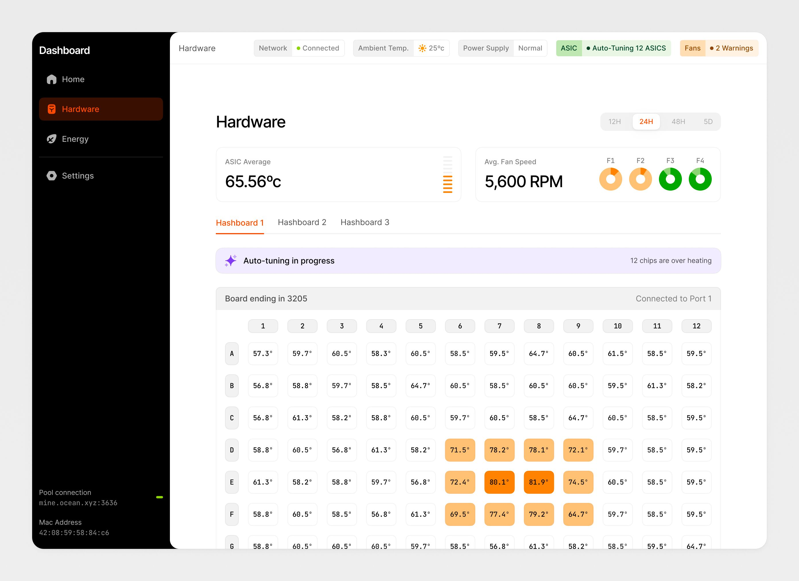
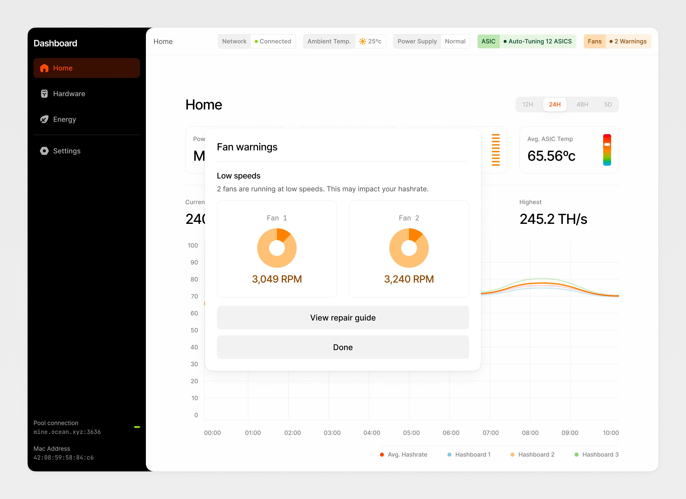
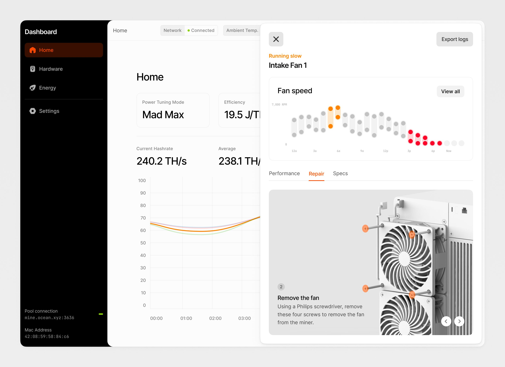

We’ve previously shared updates on our mining development kit (MDK) and ASIC hardware development projects. But, as with any hardware, the software that controls it is key to enabling its functionality. In this post, we want to provide some insight into the directions we are exploring with our mining firmware, API, and user interface.

Mining software controls the operation of and interaction between the various hardware components and subsystems within the miner (in particular the ASICs, fans, and power supply), as well as communication with external services such as mining pools and miner management systems, which manage fleets of miners within large mining facilities. Mining software also allows remote monitoring and control of mining hardware, at both the individual miner level, and at the fleet level (via miner management systems), as well as supporting diagnostics, troubleshooting, and repair of miners.

In many existing mining systems the level of control and diagnostics offered by the manufacturer’s software is limited. As a result, a number of third party firmware solutions have arisen, allowing miners to gain more visibility into, and fine-grained control over, key aspects of a miner’s operation, including management of ASIC frequency and power consumption. However, the development of these third party firmware solutions is challenged by the lack of transparency from the hardware vendors, and deployment of these solutions by mining operators generally results in voiding of the hardware manufacturer’s warranty.

**Performance monitoring.** Dashboards will provide real-time KPIs including power efficiency, hashrate, and power consumption, by hashboard and overall system.

{: loading="lazy"}

Performance tuning dashboard

**Power tuning.** Ability to modulate the power consumption and hashrate of the miner across a wide power range. This feature is intended to support intermittent power in offgrid mining, grid response and heat re-use applications, as well as optimization of mining operations based on market conditions.

{: loading="lazy"}

Power tuning

**ASIC diagnostics.** The customer will be able to monitor the performance of each individual ASIC, including the temperature and frequency at which it operates, and easily identify issues with particular ASICs.

{: loading="lazy"}

ASIC diagnostics

**Failure mode notifications.** Our software will identify failing components, surface component-level information to allow customers to troubleshoot problems, and provide specific remedial actions to the user. This will help to streamline maintenance and repair efforts.

{: loading="lazy"}

Failure warnings

{: loading="lazy"}

Warnings

By empowering customers with this feature set, we believe our mining hardware will be capable of supporting a wider range of use cases, including heat re-use and stranded power applications, as well as traditional mining. The user interface will offer a clean, streamlined user experience designed to optimally surface key features and provide low friction access to valuable functionality (without having to dig through miner logs).

Additionally, maintenance of our mining systems will be better supported by the software, lowering the operational burden associated with deployment of our mining hardware. We intend to offer a robust API documentation package, allowing developers of miner management systems and other third party applications to integrate with our mining software. Finally, in the interest of transparency, we intend to make our mining firmware accessible to developers who might want to modify or extend the feature set. We hope these measures will contribute to a better user experience for mining operators, leading to greater adoption of bitcoin mining hardware for a wider set of use cases.

## Next steps

We’d love to hear feedback and input on what we’ve outlined in this post. What features do you think are important? Is there anything we’ve missed here? Please reach out to us at [mining@block.xyz](mailto:mining@block.xyz) with any comments or feedback.

We will continue to share updates and listen to feedback as we continue to define and develop our mining products. Stay tuned for further updates on our mining hardware program in the coming weeks and months.
